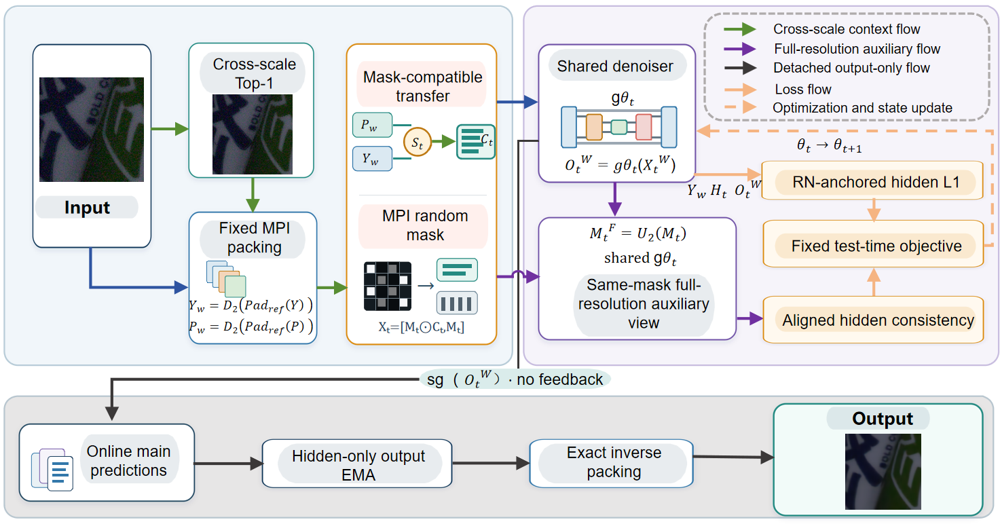

# MINTR

**MINTR: Mask-Compatible Internal Non-local Transfer for Single-Image Zero-Shot Real-World Denoising**

Official project repository for **MINTR**, a single-image zero-shot real-world image denoising framework.

**Paper Status:** Submitted to *Pattern Recognition* (under review).

**Code Status:** Code and implementation instructions will be released upon acceptance.

---

## Abstract

Single-image zero-shot denoising offers a practical solution for real-world image restoration without target-domain training data. However, masked pretrained denoisers suffer from limited visible context, while directly introducing pseudo observations may compromise the masking protocol. To address these challenges, we propose MINTR, a mask-compatible internal non-local transfer framework for real-world denoising. MINTR incorporates cross-scale pseudo observations as visibility-gated context rather than reconstruction targets, while retaining the original noisy image for hidden-region supervision. Furthermore, shared-denoiser cross-representation consistency coordinates packed-domain and full-resolution predictions using a deterministically mapped auxiliary mask. Experiments on SIDD Validation and DND achieve 36.57 dB/0.8735 and 37.0632 dB/0.9245 in PSNR/SSIM, respectively, obtaining the highest PSNR among the compared zero-shot methods with reported results. Compared with NLR on SIDD, MINTR improves PSNR by 0.31 dB while reducing runtime by 70.7% under identical hardware and timing conditions. Additional ablations support the effectiveness of the proposed framework.

## Framework Overview

**Figure 1.** Overview of the proposed MINTR framework. Cross-scale non-local information is introduced as mask-compatible context, while the original noisy observation provides reconstruction supervision. A shared denoiser performs cross-representation adaptation, followed by MPI-style hidden-only online reconstruction.

## Key Features

- **Mask-Compatible Context Transfer:** Exploits cross-scale image-internal recurrence as visibility-gated contextual information rather than directly refilling hidden prediction locations.

- **RN-Anchored Supervision:** Retains the original noisy observation as the hidden-region regression target, separating contextual information from reconstruction supervision.

- **Shared-Mask Cross-Representation Adaptation:** Coordinates packed-domain and full-resolution predictions using a shared denoiser and a deterministically mapped auxiliary visibility mask.

- **Single-Image Test-Time Adaptation:** Performs image-specific adaptation using a pretrained masked denoiser without requiring paired target-domain training data.

## Experimental Results

MINTR is evaluated on four real-world denoising datasets.

| Dataset | PSNR (dB) ↑ | SSIM ↑ |
|---|---:|---:|
| SIDD Validation | **36.57** | 0.8735 |
| DND (sRGB) | **37.0632** | 0.9245 |
| CC15 | 34.61 | 0.9152 |
| PolyU100 | 36.00 | 0.9391 |

On SIDD Validation, MINTR improves PSNR by approximately **0.31 dB** compared with NLR, while reducing average per-image runtime from **30.85 s to 9.04 s** under identical GPU and timing conditions.

Additional component ablations, repeated-seed analyses, and cross-dataset evaluations investigate the effectiveness and limitations of the proposed approach.

## Code Release

The manuscript has been submitted to *Pattern Recognition* and is currently under review.

The source code, pretrained model information, evaluation instructions, and reproducibility details will be made available upon paper acceptance.

Thank you for your interest in our work.

## Citation

If you find this work useful, please consider citing our paper once its bibliographic information becomes available.

The official BibTeX entry will be provided following publication.
